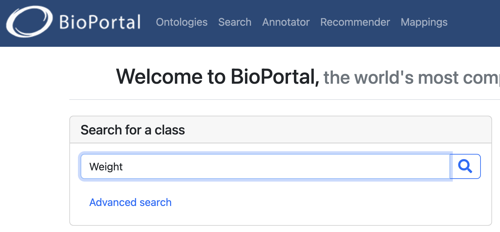
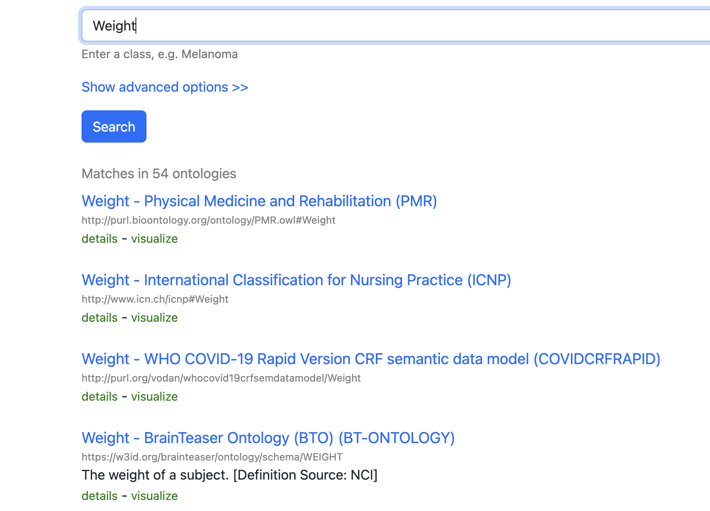
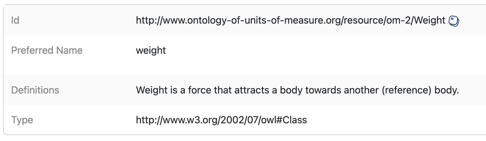

:::::::::::::::::::: questions

- What are data descriptions?
- How can data descriptions be reused?
- Are there standard ways to create data descriptions?
- What is the relationship between data descriptions and linked data?

:::::::::::::::::::::
  
:::::::::::::::::::: objectives

- Recognize that different communities use different names for data descriptions.
- Learn how to build machine-friendly data description files.
- Understand why reusing ontology terms improves interoperability.

:::::::::::::::::::::::::

> **FAIR principles used in Data Descriptions**
> 
> - **Interoperable**   
> FM-I1 (Use a Knowledge Representation Language) → [doi.org/10.25504/FAIRsharing.jLpL6i](https://doi.org/10.25504/FAIRsharing.jLpL6i)  
> FM-I2 (Use FAIR Vocabularies) → [doi.org/10.25504/FAIRsharing.jLpL6i](https://doi.org/10.25504/FAIRsharing.0A9kNV)  
>
> - **Reusable**  
> FM-R1.3 (Meets Community Standards) → [doi.org/10.25504/FAIRsharing.cuyPH9](https://doi.org/10.25504/FAIRsharing.cuyPH9)  

## 1. What are Data Descriptions?

Data descriptions document the meaning of each data attribute or variable in a dataset.

Depending on the discipline, similar documents may be called:

- codebooks
- data dictionaries
- labels or data tags
- data glossaries

For example:  

|Variable Name | Description| Scale|
|---|---|---|
| Weight | Weight of patient | kilograms |
| Height | Height of patient | centimetres |
| Age | Age of patient | years |
| Blood Glucose Level | Blood glucose level | mg/dl |

### Different fields use different names for data descriptions

No matter what the document is called, the goal is the same: to describe what the dataset variables mean so others can interpret and reuse the data correctly.

## 2. How can data descriptions be reused?

Writing documentation takes time, so when possible you should reuse accepted community definitions instead of inventing a new description every time.

**Ontologies** (in information science) are vocabularies of curated terms and their definitions.

BioPortal is a good example of a registry where community-maintained ontology terms can be searched and reused: 

- Bioportal: <https://bioportal.bioontology.org/>

{alt='BioPortal search results interface'}
{alt='Different ontology matches for the same concept'}
{alt='Ontology entry with persistent identifier'}

### Reuse ontology terms when possible 

Advantages:

- you do not need to redefine common concepts repeatedly
- you gain a persistent identifier for the concept
- other systems can align variables across datasets more easily

Disadvantages:

- sometimes no existing ontology fits the exact concept you need

## 3. Are there standard ways to create data descriptions?

There is no single universal format, but the minimum useful description usually includes:

- the variable name
- a definition
- ideally, a link to the reused ontology term or community definition

Some general-purpose vocabularies and metadata schemas include:

| Ontology | Link | Use |
| --- | --- | --- |
|Schema.org | [https://schema.org/](https://schema.org/)| Generic web concepts |
|DBpedia | [https://www.dbpedia.org/resources/lookup/](https://www.dbpedia.org/resources/lookup/)| Concepts derived from Wikipedia |
|Data Catalog Vocabulary (DCAT) | [https://www.w3.org/TR/vocab-dcat-2/](https://www.w3.org/TR/vocab-dcat-2/)| Data catalogue concepts |
|Dublin Core | [https://www.dublincore.org/specifications/dublin-core/dcmi-terms/](https://www.dublincore.org/specifications/dublin-core/dcmi-terms/)| General metadata terms |

Public registries that help locate vocabularies include:

- Linked Open Vocabularies: <https://lov.linkeddata.es/dataset/lov/>
- EU Vocabularies: <https://op.europa.eu/en/web/eu-vocabularies>
- BioPortal: <https://bioportal.bioontology.org/>
- AgroPortal: <https://agroportal.lirmm.fr/>
- EcoPortal: <https://ecoportal.lifewatchitaly.eu/>
- Ontology Lookup Service: <https://www.ebi.ac.uk/ols/index>
- Bioschemas: <https://bioschemas.org/>

:::::::::::::::: challenge

### Bioportal

Visit [BioPortal](https://bioportal.bioontology.org/). BioPortal is the most known repository for biomedical ontologies.  
Search for a term describing `blood glucose level` in the 'search for a class box'.

What ontology term would you reuse, and what persistent identifier does it provide?

::::::::::::::: solution

There is more than one possible match, but a valid answer is to identify a term such as the clinical measurement concept and record its ontology URI or other persistent identifier provided by the registry.

::::::::::::::::::
::::::::::::::::::

Data descriptions are often maintained as tables in `.csv`, `.xlsx`, or similar formats. For databases, it is also useful to provide both a machine-readable schema and a human-readable diagram.

{alt="tabular"}

Other human-friendly approaches include dataset nutrition labels and automated codebook tools, but the FAIR principles push further toward structured, machine-actionable formats.

## 4. What is the relationship between data descriptions and linked data?

When data descriptions reuse ontology terms and stable identifiers, datasets can be transformed into linked data formats such as RDF and become easier to combine with other resources (or 'interoperable').

Tools that can help with this include:

|Tool | Source | GUI | Note|
| ---| ---|---|---|
|Open Refine | [https://openrefine.org/](https://openrefine.org/)| ✅| Installation can be a hassle and takes a lot of memory |
|RMLmapper | [https://github.com/RMLio/rmlmapper-java/releases](https://github.com/RMLio/rmlmapper-java/releases)| ❌| Highly technical as you need to know command line tools; preferred option of data engineers   |
|SDM-RDFizer | [https://github.com/SDM-TIB/SDM-RDFizer](https://github.com/SDM-TIB/SDM-RDFizer)| ❌ | You need to be familiar with programming languages |
|SPARQL-Generate | [https://ci.mines-stetienne.fr/sparql-generate/](https://ci.mines-stetienne.fr/sparql-generate/)| ✅| Good option if you want to learn SPARQL language |
|Virtuoso Universal Serve | [https://virtuoso.openlinksw.com/](https://virtuoso.openlinksw.com/)| ✅| Commercial licensing may apply |
|UM LDWizard | [https://github.com/MaastrichtU-IDS/ldwizard-humanities](https://github.com/MaastrichtU-IDS/ldwizard-humanities)| ✅| Quick route to publishable linked data |

::::::::::::::::::: challenge

###Transforming to RDF

Download the mock dataset if you haven't already and save to your Desktop: [MOCK DATA](../data/MOCK_DATA_BOOTCAMP.xlsx)  
Convert the dataset into RDF using [UM LDWizard](https://github.com/MaastrichtU-IDS/ldwizard-humanities)  

What ontology terms did you reuse to describe the data attributes?  

::::::::::::::::::: solution

There is no single correct answer. The important part is to reuse existing ontology terms where possible and document the choices you made.

:::::::::::::::
::::::::::::::

:::::::::::::::::::: discussion  

Marine Biology Scenario

Your marine biology group has discovered new organisms, but you cannot find an existing ontology that fits the concepts you need.

What should you do? Should you adapt an existing vocabulary, create local terms, or work with the community toward a new ontology extension?

:::::::::::::::::::::::

:::::::::::::::::: keypoints

- Data descriptions may appear under names such as codebook or data dictionary.
- Reusing ontology terms reduces ambiguity and improves interoperability.
- A useful description links dataset variables to accepted community concepts.
- Linked data becomes more feasible when descriptions are structured and identifier-based.

::::::::::::::::::::::::
