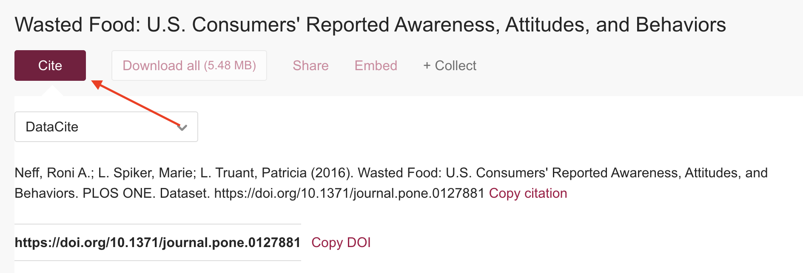
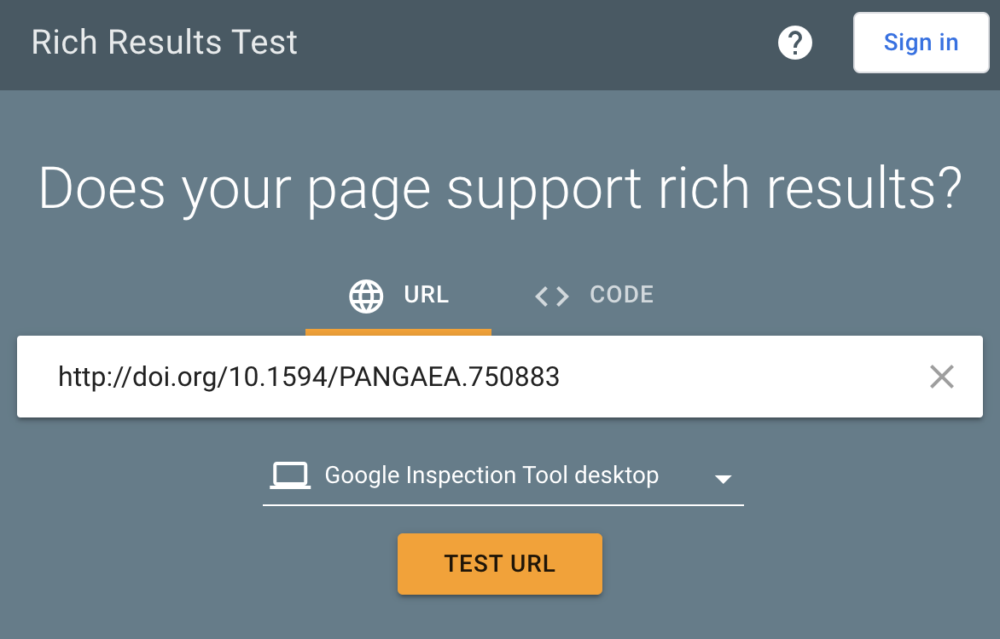
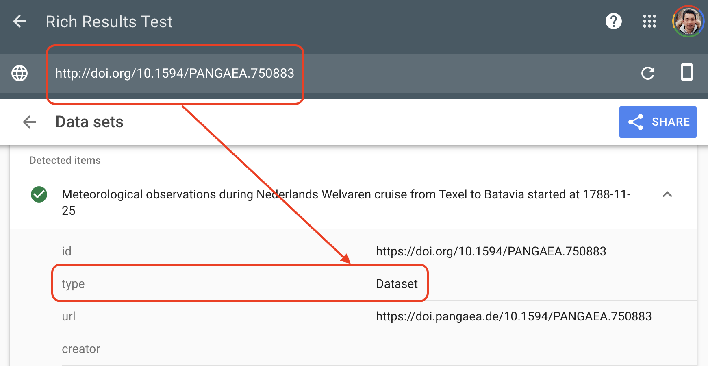

::::::::::::::: questions

- How should data be cited when reusing a data source?
- How can you check whether data is likely to be reused and discovered?

::::::::::::::::::

::::::::::::::::: objectives

- Understand the importance of citing datasets.
- Learn how discoverability testing supports future data reuse.
- Connect reuse to rich metadata and structured web data.

::::::::::::::::::

> **FAIR principles used in Data Reusing**  
>
> **Findable**   
> FM-F1B (Identifier persistence) → [doi.org/10.25504/FAIRsharing.TUq8Zj](https://doi.org/10.25504/FAIRsharing.TUq8Zj)  
> FM-F4 (Indexed in a Searchable Resource) → [doi.org/10.25504/FAIRsharing.Lcws1N](https://doi.org/10.25504/FAIRsharing.Lcws1N)  
>
> **Reusable**  
> FM-R1.2 (Detailed Provenance) → [doi.org/10.25504/FAIRsharing.qcziIV](https://doi.org/10.25504/FAIRsharing.qcziIV)  

## 1. How should data be cited when reusing a data source?

Data reuse means working with an existing research data source rather than generating all material from scratch.

At minimum, a dataset citation should include:

- creator
- publication year
- title
- resource type or version
- publisher
- persistent identifier, usually DOI

Example citation:

> Neff, Roni A.; L. Spiker, Marie; L. Truant, Patricia (2016). Wasted Food:
> U.S. Consumers' Reported Awareness, Attitudes, and Behaviors. PLOS ONE.
> Dataset. <https://doi.org/10.1371/journal.pone.0127881>

Original dataset example:

- <https://figshare.com/articles/dataset/_Wasted_Food_U_S_Consumers_Reported_Awareness_Attitudes_and_Behaviors_/1445199>

{alt='Dataset repository page with citation tools'}

### Standard citations improve discoverability

When datasets are cited in recognizable formats, citation indexes and data aggregators can track those references much more effectively.

## 2. How can you check whether data is likely to be reused and discovered?

Datasets are digital objects on the web. To be reused, they must first be easy to find. That depends heavily on rich metadata and structured web markup.

Google's Rich Results Test is one way to inspect whether a dataset page exposes structured information machines can recognize:

- <https://search.google.com/test/rich-results>

Example test:

- <https://search.google.com/test/rich-results?url=http%3A%2F%2Fdoi.org%2F10.1594%2FPANGAEA.750883>

{alt='Entering a dataset URL in Google Rich Results Test'}
{alt='Test results after checking a dataset URL'}

### Without rich metadata, data can be effectively invisible

A dataset may be accessible to humans through a webpage and still remain hard for search engines or data aggregators to interpret.


::::::::::::: challenge

### Google's Rich Results Test

Visit the Culture Crime News database:

<https://news.culturecrime.org/all>

Run Google's Rich Results Test on that resource.

Did the test detect a structured dataset?

::::::::::::::::: solution

No. This is a useful reminder that a human-friendly page is not automatically a machine-friendly dataset description.

::::::::::::::::::::
:::::::::::::::::::::::

If you want to go further, review Google's explanation of the Rich Results Test:

- <https://support.google.com/webmasters/answer/7445569>

Search engines and data aggregators rely on shared standards such as:

- Schema.org dataset markup: <https://schema.org/Dataset>
- DCAT: <https://www.w3.org/TR/vocab-dcat/>
- Semantic Web concepts more broadly:
  <https://en.wikipedia.org/wiki/Semantic_Web>

An example of dataset-oriented JSON-LD:

```json
{
  "@context": "https://schema.org/",
  "@type": "Dataset",
  "name": "Dummy Data",
  "description": "This is an example for the coursebook",
  "url": "https://example.com",
  "identifier": ["https://doi.org/XXXXXX"],
  "license": "https://creativecommons.org/publicdomain/zero/1.0/",
  "isAccessibleForFree": true
}
```

:::::::::::::: challenge

### Rich Metadata File Similarities

Visit the dataset you uploaded in the Data Archiving episode. Download the Rich Metadata file (JSON-LD) format.

What similarities do you find with the above example?

::::::::::::::::: solution

The format is JSON-LD: type="application/ld+json"

The vocabulary is Schema.Org: "@context":"https://schema.org/"  

The type is a Dataset: "@type":"Dataset"

::::::::::::::::::::
::::::::::::::::::::


::::::::::::::: discussion  

Select datasets from previous examples. Perform FAIR tests in [FAIR enough](https://fair-enough.semanticscience.org/)  

What can you tell from the FAIR scores?

::::::::::::::::::::::::::::::

:::::::::::::::::: keypoints

- 'Digital Objects (e.g., Datasets) "live" on the web, imagine they are like fishes in the sea 🐠🐠. The way to get picked up by a "fisherman" 🎣 i.e., a search engine (e.g., Google) is by describing these Digital Objects with Rich Metadata.'

:::::::::::::::::::::
