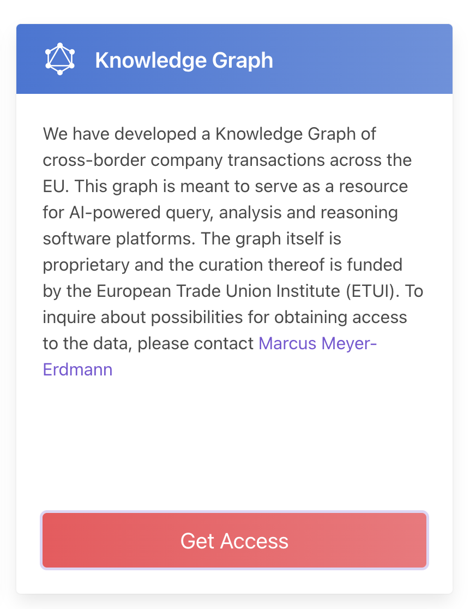
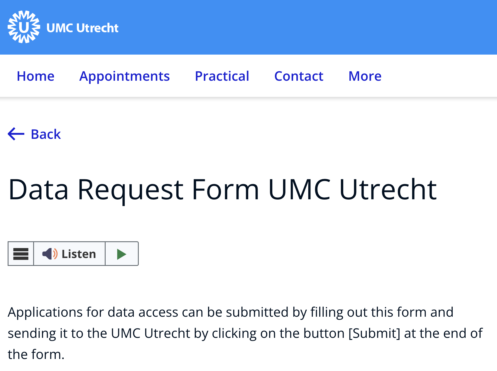
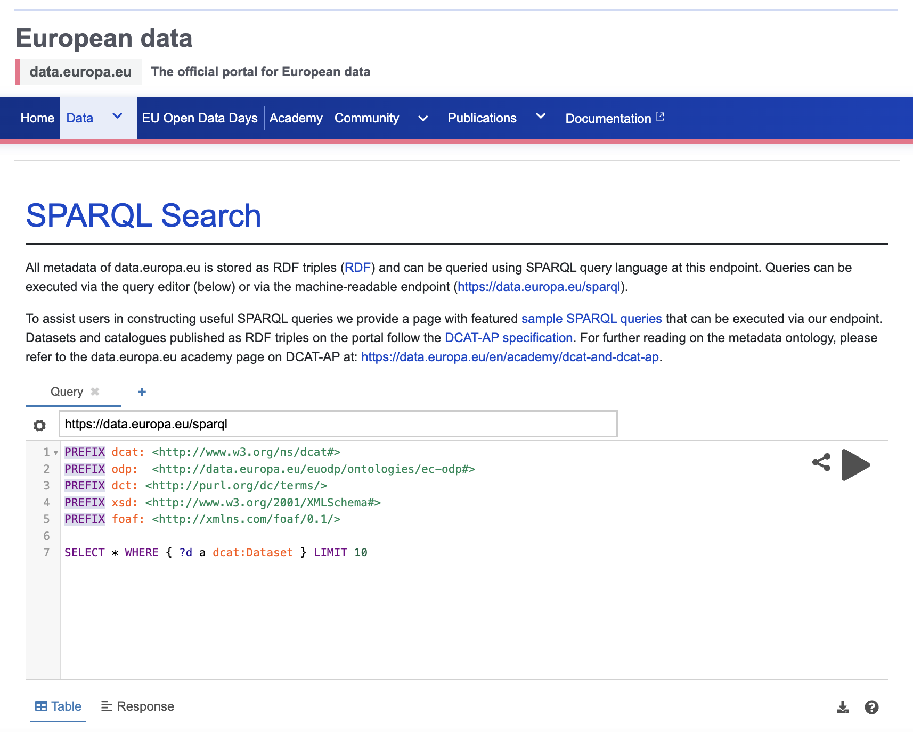

:::::::::::::::::::::: questions

- What are data access protocols?
- Is open access a data access protocol?
- Can data be exposed as a service through FAIR API protocols?

:::::::::::::::::::::::::::
  
:::::::::::::::::::: objectives

- Learn what data access protocols are.
- Distinguish between human-facing and machine-facing access instructions.
- Explore how FAIR API protocols can expose data as a service.

::::::::::::::::::::::::

> **FAIR principles used in Data Access Protocols:**
>
> **Accessible**   
> FM-A1.1 (Access Protocol) → [doi.org/10.25504/FAIRsharing.yDJci5](https://doi.org/10.25504/FAIRsharing.yDJci5)  
> FM-A1.2 (Access Authorization) → [doi.org/10.25504/FAIRsharing.EwnE1n](https://doi.org/10.25504/FAIRsharing.EwnE1n)  
>
> **Interoperable**  
> FM-I3 (Use Qualified References) → [doi.org/10.25504/FAIRsharing.B2sbNh](https://doi.org/10.25504/FAIRsharing.B2sbNh)  

## 1. What are Data Access Protocols?

Data access protocols are the explicit rules and steps that tell humans or machines how to access a data source.

{alt="access" width=800}

Just as you need the correct key, code, or procedure to enter a secure room, data access often depends on following the correct process.  

| Access Protocol | Example | | Note |
| --- | --- | --- | --- |
| Communication between machines | HTTP request or API call | {alt='Example of a human-oriented access workflow'} | A machine requests information using a standard network protocol |
| Communication between humans | {alt='Screenshot of a human-facing data request form'} | Data request form or email workflow | A person follows explicit instructions to request access |

### Protocols are rules communicated in a shared language

Humans may use a written access policy or form written in English, while machines use Application Programming Interfaces (APIs) and network protocols such as [HTTP](https://en.wikipedia.org/wiki/Hypertext_Transfer_Protocol). Common [API](https://en.wikipedia.org/wiki/Web_API) styles include [SOAP](https://en.wikipedia.org/wiki/SOAP), [REST](https://en.wikipedia.org/wiki/Representational_state_transfer), and [SPARQL](https://en.wikipedia.org/wiki/SPARQL).

## 2. Is Open Access a data access protocol?

Strictly speaking, open access is a policy framework rather than a network protocol, but in practice it functions as an access model with explicit rules: the data can be retrieved openly without individual authorization.

Depositing data in a public repository often gives the resource an open-access access route automatically. Some open datasets also expose machine-readable access through APIs or SPARQL endpoints. 

Example:  

- EU public data SPARQL interface:
  <https://data.europa.eu/data/sparql>
- Endpoint:
  <https://data.europa.eu/sparql>

{alt='Screenshot of a SPARQL endpoint example'}

:::::::::::::: challenge

### Zenodo

Visit the Zenodo COVID-19 community: <https://zenodo.org/communities/covid-19/>

What is the default data access protocol visible for the displayed records?

:::::::::::::::::: solution

The records are presented as open access resources, which is visible through the repository interface and download behaviour.

::::::::::::::::::
::::::::::::::::::::

### Open Access can be human-friendly and machine-friendly

Humans see direct download options. Machines see stable web requests and, insome systems, structured service endpoints. 

## 3. Can data be exposed as a service through FAIR API protocols?

Yes, but it requires technical infrastructure and some familiarity with linked data or [knowledge graph](https://en.wikipedia.org/wiki/Knowledge_graph) tooling.
More information about this can be found in the [FAIR Elixir Cookbook](https://faircookbook.elixir-europe.org/content/recipes/introduction/FAIR-and-knowledge-graphs.html).

Useful tools include:

| Tool | Source | GUI | Note|
| --- | --- | --- | --- |
| TriplyDB | [https://triplydb.com/](https://triplydb.com/)| ✅| Quick hosted option for exposing data |
| GraphDB | [https://www.ontotext.com/products/graphdb/](https://www.ontotext.com/products/graphdb/)| ✅| Requires a server or managed deployment |
| FAIR Data Point | [https://github.com/fair-data/fairdatapoint](https://github.com/fair-data/fairdatapoint)| ❌ | Powerful but technical |
| RDFlib Endpoint | [https://pypi.org/project/rdflib-endpoint/](https://pypi.org/project/rdflib-endpoint/)| ❌| Fast local route for experimentation |

::::::::::::::::::::::::::::::::::::: callout

### Register FAIR APIs where others can find them

If you expose a FAIR API or similar service endpoint, register it in an appropriate service registry such as SMART API: <https://www.smart-api.info/>

::::::::::::::::::::::::::::::::::::::::::::::::

:::::::::::::::::::::::::
::::::::::::::::::: challenge

### Optional API Exercise

1. Register for `TriplyDB` using a google or github account
2. Click on Create Dataset. Name your dataset TEST and then click "Add Dataset"
3. Using the option to add data from files, upload the RDF data you generated in the data descriptions episode (it is a .ttl file), clicking "Import from files".
4. Once uploaded, copy the URL from the browser and then log out of your account. You should be able to return to that page and still see the data.
5. Click on Triples in the menu on the left-hand side of the page and search for all the entries for "Pink" in the object box

How many entries were there for the colour pink?

::::::::::::::::::::: solution

There are three. Well done for exposing your data through a public API!

::::::::::::::::::::::::::
:::::::::::::::::::::::::::::

::::::::::::::::::::: discussion  

### Data Access

You have sensitive financial information that cannot be openly disclosed, but still want to enable legitimate research access.

What kind of human and machine access protocols would you design? What should be openly visible, and what should only be available behind review or controlled authorization?

::::::::::::::::

::::::::::::::: keypoints

- Data access protocols describe how humans and machines gain access to data.
- Open access is an access model that can still be expressed through explicit rules and interfaces.
- Human-facing request forms and machine-facing APIs are both important access patterns in FAIR data practice.
- FAIR service endpoints are more useful when they are registered and discoverable.

::::::::::::::::::
